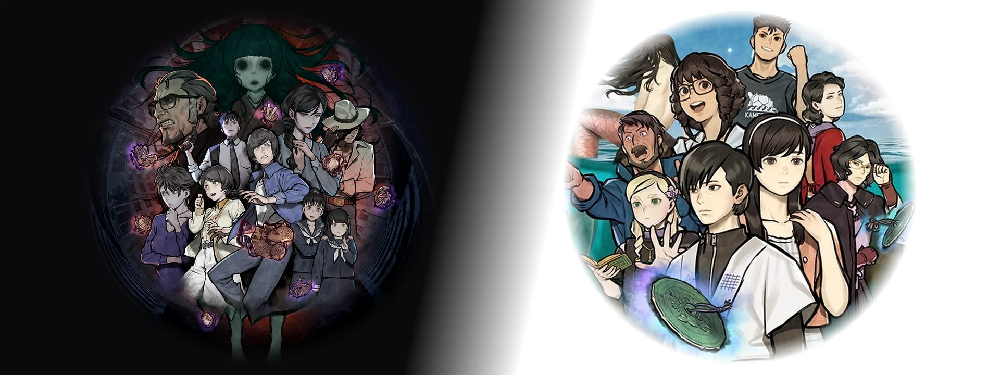
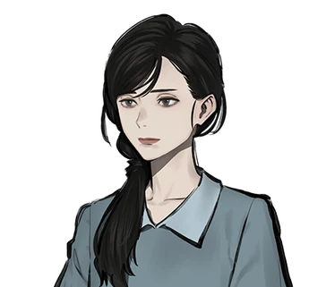
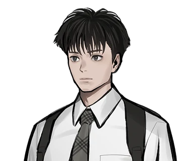
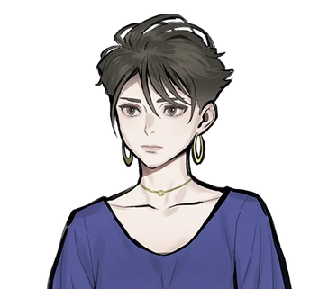
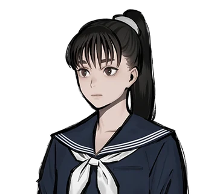
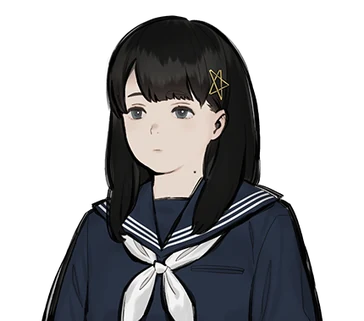

  

<h1 align="center">파라노마사이트 시리즈 한글 패치</h1>

  PARANORMASIGHT FILE23 혼조 7대 불가사의 · FILE38 이세 인어 이야기 
  비공식 한국어 번역 패치 · 한글 패치 제작 <b>SAKURA</b>

  
  
  

  
  
   
  2편 PARANORMASIGHT2_KR_v1.0.2_Setup.exe · 약 177MB · 설치 방법은 <a href="#설치와-사용">설치와 사용</a> 참고 · 1편은 번역·검수 진행 중

## 1편 FILE23 혼조 7대 불가사의

PARANORMASIGHT: The Seven Mysteries of Honjo · パラノマサイト FILE23 本所七不思議

> [!IMPORTANT]
> ### 📝 텍스트 15,940행 초벌 번역 완료 · 검수 진행 중
> **본편 · 선택지 · 자료/인물 · 스토리 차트 · 도전 과제 · 메뉴 · 콧쿠리 문자판** 등 게임 안 텍스트 **15,940행**과 스태프 크레디트 **159행**을 일본어 원문 기준으로 초벌 번역했고, 진행에 필요한 그림 속 글자 **43장**을 한글로 다시 그렸습니다. 지금은 테스트 빌드로 실제 화면을 확인하며 문장 검수와 그림 속 글자 한글화를 진행하고 있습니다. 공개 일정은 [소개 페이지](https://deuxdoom.github.io/PARANORMASIGHT-KR-Patch/#file23)와 [GitHub Releases](https://github.com/deuxdoom/PARANORMASIGHT-KR-Patch/releases)에서 알려 드립니다.

### 소개

『파라노마사이트 FILE23 혼조 7대 불가사의』는 스퀘어 에닉스의 호러 미스터리 어드벤처 게임입니다. 쇼와 후기의 도쿄도 스미다구를 무대로, 저주의 힘을 얻은 사람들이 혼조 7대 불가사의에 숨겨진 《부활의 비술》을 둘러싸고 서로 맞섭니다. 2023년 3월 9일에 Nintendo Switch, PC(Steam), iOS, Android로 출시되었으며, 정식 한국어는 지원하지 않습니다.

이 패치는 일본어 원문을 기준으로 대사, 선택지, 자료, 메뉴, 인물 소개, 스태프 크레디트를 한국어로 옮깁니다. 게임의 일본어 언어 설정 자리에 한국어가 표시되는 방식입니다.

### 원작 소개

원작 공식 사이트의 줄거리, 등장인물, 제작 스태프 소개를 한국어로 옮겼습니다. 제목을 누르면 펼쳐집니다.

<b>줄거리</b>

 

쇼와 후기의 <b>도쿄도 스미다구</b>를 무대로, 
저주의 힘을 얻은 9명의 남녀가 
<b>7대 불가사의</b>에 숨겨진 <b>《부활의 비술》</b>을 
누가 쓸지를 두고 저마다의 마음을 부딪치는 
<b>군상 호러 미스터리 어드벤처</b>. 
 
마지막에 당신을 기다리는 <b>수수께끼</b>란…!?

<b>등장인물</b>

 

| 인물 | 직업 · 나이 |
|---|---|
|  **오키이에 쇼고** 興家 彰吾 · Shogo Okiie | 회사원 · 25세 |
|  **후쿠나가 요코** 福永 葉子 · Yoko Fukunaga | 가사 보조 · 23세 |
|  **시기마 하루에** 志岐間 春恵 · Harue Shigima | 주부 · 36세 |
|  **카이 리히타** 櫂 利飛太 · Richter Kai | 사립 탐정 · 28세 |
|  **츠츠미 테츠오** 津詰 徹生 · Tetsuo Tsutsumi | 형사 · 50세 |
|  **에리오 준** 襟尾 純 · Jun Erio | 형사 · 28세 |
|  **초자와 마유** 蝶澤 麻由 · Mayu Chozawa | 미용사 · 27세 |
|  **사카자키 얏코** 逆崎 約子 · Yakko Sakazaki | 고등학생 · 17세 |
|  **쿠로스즈 미오** 黒鈴 ミヲ · Mio Kurosuzu | 고등학생 · 16세 |
|  **시라이시 미치요** 白石 美智代 · Michiyo Shiraishi | 고등학생 · 17세 |

<b>제작 스태프</b>

 

| 담당 | 이름 | 주요 참여작 |
|---|---|---|
| 디렉터 / 시나리오 | **이시야마 타카나리** 石山貴也 | 「스쿨걸 스트라이커즈」, 「탐정 케부카와 료스케 사건담」 시리즈(And Joy 작품) 등 |
| 캐릭터 디자인 | **코바야시 겐** 小林 元 | 「스쿨걸 스트라이커즈」, 「すばらしきこのせかい(The World Ends with You)」 시리즈 등 |

출처: [원작 공식 사이트(일본어)](https://www.jp.square-enix.com/paranormasight/)의 소개 문구와 인물 정보를 한국어로 옮겼습니다. © SQUARE ENIX

### 지원 환경 (예정)

- **Windows용 Steam판**을 대상으로 준비하고 있습니다 (Steam AppID `2106840`).
- Nintendo Switch, iOS, Android판과 Steam 이외의 PC판은 지원하지 않을 예정입니다.
- 게임을 정상적으로 구매해 설치한 상태여야 합니다. 배포 파일에는 원본 게임 파일을 넣지 않습니다.
- 설치 파일과 설치·되돌리기 방법, 적용 화면은 공개할 때 안내합니다.

## 2편 FILE38 이세 인어 이야기

PARANORMASIGHT: The Mermaid's Curse · パラノマサイト FILE38 伊勢人魚物語

> [!TIP]
> ### ✅ 텍스트 14,156행 전부 번역·검수 완료
> **본편 · 선택지 · 자료/머리글 · 인물 · 차트 · 미니게임 · 엔딩 · 극장** 등 게임 안 텍스트 **14,156행**과 스태프 크레디트 **433행**을 하나도 빠짐없이 번역하고, 모두 일본어 원문과 대조해 검수했습니다. 진행에 필요한 그림 속 글자(**핵심 이미지 14종**)도 한글화와 검수를 마쳤습니다.

> [!IMPORTANT]
> **정식 v1.0.2를 배포합니다.** 위 버튼에서 설치 프로그램을 내려받아 실행해 주세요. 기존 `.bak`은 보존하며, 새 백업은 원본과 일치하는 파일만 만듭니다. 제거하면 남아 있는 `.bak`을 복원합니다. 자세한 방법은 [설치와 사용](#설치와-사용), 수정 내용은 [변경 이력](CHANGELOG_2.md)을 확인해 주세요.

### 소개

『파라노마사이트 FILE38: 이세 인어 이야기』는 스퀘어 에닉스의 미스터리 어드벤처 게임입니다. 198x년 여름, 미에현 이세만에 떠 있는 외딴섬 카메시마를 무대로 인어 전설과 섬을 덮친 저주를 쫓아갑니다. 2026년 2월 19일에 Nintendo Switch, PC(Steam), iOS, Android로 출시되었으며, 정식 한국어는 지원하지 않습니다.

이 패치는 일본어 원문을 기준으로 게임 안의 대사, 선택지, 자료, 메뉴, 인물 소개, 스태프 크레디트를 한국어로 옮깁니다. 게임의 일본어 언어 설정 자리에 한국어가 표시되는 방식입니다.

### 원작 소개

원작 공식 사이트의 줄거리, 등장인물, 제작 스태프 소개를 한국어로 옮겼습니다. 제목을 누르면 펼쳐집니다.

<b>줄거리</b>

 

무대는 미에현 이세시마 지방. 
<b>불로불사</b>를 가져다준다는 인어의 수수께끼를 둘러싸고 
여름 외딴섬에서 펼쳐지는 군상극 전기(傳奇) 미스터리. 
등장인물 저마다의 속셈이 얽히고설키며 
이윽고 수백 년의 역사를 넘나드는 인어의 저주를 둘러싼 
<b>경악할 드라마</b>로 이어져 간다.

<b>등장인물</b>

 

| 인물 | 소개 |
|---|---|
|  **미나구치 유자** 水口 勇佐 · Yuza Minakuchi | 카메시마에 사는, 성실하면서도 마이페이스인 소년. 은퇴한 할머니의 뒤를 이어 해녀 일을 시작했다. 5년 전 해난 사고로 부모님을 잃었고, 그때 어떤 신비한 일을 겪었다. |
|  **쿠모이 아자미** 雲居 アザミ · Azami Kumoi | 미나구치 유자의 소꿉친구이자 단짝. 세상을 떠난 아버지의 어선을 물려받아 어부로 일한다. 남을 잘 챙겨 주변에서 의지하는 타입으로, 고향 사랑만큼은 누구보다 강하다고 자부한다. |
|  **시라나미 사토** 白浪 里 · Sato Shiranami | 몇 달 전 카메시마에 흘러들어 온 수수께끼의 소녀. 기억을 잃은 것 같은데……. |
|  **아와오 츠카사** 沫緒 つかさ · Tsukasa Awao | 카메시마에서 나고 자란 밝고 활발한 소녀. 지금은 고등학교에 다니려고 본토에서 하숙하고 있다. 미나구치 유자, 쿠모이 아자미와는 소꿉친구. 고향에 내려온 동안 시라나미 사토와 친해졌다. |
|  **아르나브 바넘** アルナーヴ・バーナム · Arnav Barnum | 낭만을 찾아 일본에 온 미국인. 본업은 판타지 작가 겸 오컬트 라이터. 아무래도 이세시마에서 인어를 찾고 있는 모양이다. 애칭은 ‘아비’. 40세. 독신. |
|  **키르케 루나라이트** キルケ・ルナーライト · Circe Lunarlight | 《엑소시스트》 소녀. 영국 명문가 출신으로 일본에 유학 중이다. 일본의 전승과 오컬트에 밝아, 친척인 아비의 부탁으로 가이드를 맡고 있다. |
|  **시키 유메코** 志貴 結命子 · Yumeko Shiki | 자칭 도쿄의 주부. 무언가를 조사하고 있는 모양인데……. |
|  **키류 소도** 霧生 双奴 · Sodo Kiryu | 시키 유메코의 조수로 일하는 청년. 범상치 않은 분위기를 풍긴다. |

<b>제작 스태프</b>

 

| 담당 | 이름 | 주요 참여작 |
|---|---|---|
| 디렉터 / 시나리오 | **이시야마 타카나리** 石山貴也 | 「스쿨걸 스트라이커즈」, 「파라노마사이트 FILE23 혼조 칠대 불가사의」 등 |
| 캐릭터 디자인 | **코바야시 겐** 小林 元 | 「스쿨걸 스트라이커즈」, 「파라노마사이트 FILE23 혼조 칠대 불가사의」 등 |
| 사운드 컴포저 | **이와사키 히데노리** 岩﨑英則 | 「파이널 판타지 크리스탈 크로니클 크리스탈 베어러」, 「파라노마사이트 FILE23 혼조 칠대 불가사의」 등 |

출처: [원작 공식 사이트(일본어)](https://www.jp.square-enix.com/paranormasight/file38/)의 소개 문구를 한국어로 옮겼습니다. © SQUARE ENIX

### 적용 화면

이미지를 누르면 크게 볼 수 있습니다.

   
  타이틀 화면

| **설정 · 언어 설정** | **카메시마 지도** |
|---|---|
|  |  |
| **인물 목록** | **자료 · 카메시마 남해의 대재난** |
|  |  |
| **자료 · 카메시마루** | **자료 · 이세 이야기** |
|  |  |
| **자료 · 여름의 대삼각형** | **인물 등장 · 시키 유메코** |
|  |  |
| **대화 장면** | **시작 안내 · 한글 패치 제작자 표기** |
|  |  |

### 지원 환경

- **Windows용 Steam판만 지원합니다** (Steam AppID `2701440`).
- Steam 빌드 `22496791`을 기준으로 만들었습니다. 게임이 업데이트되면 새 판본을 지원하는 패치가 나올 때까지 기다려 주세요.
- Nintendo Switch, iOS, Android판과 Steam 이외의 PC판은 지원하지 않습니다.
- 게임을 정상적으로 구매해 설치한 상태여야 합니다. 배포 파일에는 번역을 적용해 수정한 파일만 들어 있으며, 원본 게임 파일은 포함하지 않습니다.

### 설치와 사용

정식 v1.0.2 설치 파일은 EXE 하나로 구성됩니다. 게임의 일본어 자리에 한국어를 표시합니다. 기존 버전 사용자는 먼저 제거하지 않고 같은 게임 폴더에 설치하면 됩니다.

1. 게임을 종료하고 Steam 게임 **속성 → 일반 → 언어**를 **日本語(일본어)** 로 설정합니다. 내려받기가 시작되면 완료될 때까지 기다립니다.
2. [PARANORMASIGHT2_KR_v1.0.2_Setup.exe](https://github.com/deuxdoom/PARANORMASIGHT-KR-Patch/releases/download/v1.0.2/PARANORMASIGHT2_KR_v1.0.2_Setup.exe)를 실행하고 설치 확인에 동의합니다.
3. 기본 경로는 `C:\Program Files (x86)\Steam\steamapps\common\PARANORMASIGHT_2`입니다. 다른 위치에 설치했다면 **찾아보기**로 실제 게임 폴더를 선택합니다.
4. 설치가 끝나면 **완료**를 눌러 닫고 게임을 실행합니다.

  

#### 되돌리기

- Windows **설정 → 앱 → 설치된 앱**에서 **파라노마 사이트2 한국어 패치**를 제거합니다.
- 설치 목록이 없어도 게임 폴더의 `unins000.exe`로 제거할 수 있습니다. 이전 제거기에서 오류가 났다면 새 Setup을 같은 게임 폴더에 설치해 제거기를 갱신해 주세요.
- 제거할 때 설치한 파일 목록에 따라 패치 파일을 지우고, 같은 위치에 남아 있는 `파일명.bak`을 원래 이름으로 복원합니다. 중간 수정본을 덮어썼어도 제거할 수 있습니다.
- 기존 `.bak`은 덮어쓰지 않습니다. 백업이 없으면 검증된 원본 파일만 새 `.bak`으로 만들며, 이미 패치된 파일은 원본 백업으로 만들지 않습니다.
- `.bak`이 없는 대상은 제거 시 삭제됩니다. 원본 백업을 지운 경우에는 제거 후 Steam **속성 → 설치된 파일 → 게임 파일 무결성 확인**으로 게임 파일을 복구해 주세요.

> [!NOTE]
> Steam의 **게임 파일 무결성 확인**이나 게임 업데이트가 패치한 파일을 원래대로 되돌릴 수 있습니다. 게임이 업데이트되면 새 판본을 지원하는 패치가 나올 때까지 기다려 주세요.

### 알려진 제한

- 그림 속 작은 글씨와 장식 문자는 원문 그대로 남아 있습니다.
- 자료의 문장 흐름과 제보된 그림·출처 배치를 수정했습니다. 최신 수정 화면의 추가 확인과 전체 분기 플레이 검증은 계속 수집합니다. 어색한 줄바꿈이나 진행 문제를 발견하면 제보해 주세요.

### 글꼴

패치에 쓰는 글꼴입니다. 글꼴 원본은 수정하지 않았습니다.

| 글꼴 | 쓰는 곳 | 라이선스 |
|---|---|---|
| Noto Sans CJK KR | 대사·메뉴 등 기본 본문 | SIL Open Font License 1.1 (© Adobe) |
| Noto Serif CJK KR | 자료 화면 글, 자료 그림 속 문구 | SIL Open Font License 1.1 (© Adobe) |
| Pretendard | 시작 화면 저작권 주의 문구 | SIL Open Font License 1.1 |
| 마루 부리 (MaruBuri) | 인물 이름, 작은 타이틀 | SIL Open Font License 1.1 (© NAVER Corp.) |
| 조선100년체 | 큰 타이틀(이미지로 그림) | 방일영문화재단 무료 글꼴 (수정·판매 금지) |

각 글꼴의 라이선스 원문은 배포 파일의 `Font-Licenses.txt`에 함께 넣었습니다.

## 번역 기준

> [!NOTE]
> ### 🙏 번역에 대한 부탁
> 일본어 원문을 하나하나 확인하고 자연스러운 한국어로 다듬었지만, 그래도 부족한 부분이 있을 수 있습니다. 너그러운 양해 부탁드립니다.
> **오역이나 어색한 표현, 더 나은 번역이 떠오르면 언제든 적극적으로 제보해 주세요.** 보내 주신 의견은 하나하나 확인하겠습니다.
> → [소개 페이지 제보 폼](https://deuxdoom.github.io/PARANORMASIGHT-KR-Patch/#report) · [GitHub Issues](https://github.com/deuxdoom/PARANORMASIGHT-KR-Patch/issues/new)

1편과 2편은 같은 기준으로 옮깁니다. 처음 플레이하는 사람이 원작의 단서와 인물 관계, 분위기를 그대로 느낄 수 있도록 옮겼습니다.

- **일본어 원문이 기준입니다.** 영어판은 문맥을 확인하는 참고 자료로만 씁니다.
- **고유명사**는 한국 게임·애니메이션에서 널리 쓰는 표기를 따릅니다(오키이에 쇼고, 카메시마, 츠카사, 타이라노 토모시게 등). 도쿄처럼 이미 굳은 표기와 공식 명칭은 그대로 씁니다.
- **호칭과 말투**는 인물 소개의 나이와 관계, 원문의 말버릇과 사투리에 맞춥니다. 예를 들어 2편의 츠카사는 유자와 아자미를 `오빠`라고 부릅니다.
- **연도와 숫자**는 `5년 전`처럼 아라비아 숫자로 씁니다.
- **스태프 크레디트**는 업무명과 일본어 이름을 한국어로 옮기고, 아래쪽 영문 이름은 그대로 둡니다.
- **공통 용어**: 呪主는 두 작품 모두 `저주인`으로 씁니다. 음독 ‘주주’로는 뜻이 전해지지 않아 ‘저주를 지닌 사람’이라는 뜻을 살렸습니다.

### 작품별 기준

#### 1편 혼조 7대 불가사의

공개 전 검수에 따라 표기가 바뀔 수 있습니다.

- **그림 속 글자**는 크게 보이는 간판·표지·소품 글자를 원본과 비슷한 한국어 글꼴로 한글화하고, 작거나 흐린 글자는 원화 그대로 둡니다.
- **콧쿠리 퍼즐**은 문자판을 한글 음절판으로 바꾸고, 동전이 한글 음절을 하나씩 짚도록 맞춥니다.
- 타이틀 화면 오른쪽 아래 `© SQUARE ENIX` 위에 `한글 패치 : 사쿠라`를 표시합니다.

| 원문 | 한국어 | 비고 |
|---|---|---|
| 本所七不思議 | 혼조 7대 불가사의 | 작품의 중심이 되는 혼조의 일곱 괴담 |
| 蘇りの秘術 | 부활의 비술 | 죽은 사람을 되살린다는 비술 |
| 呪詛珠 | 저주옥 | 저주의 힘이 깃든 구슬 |
| 駄菓子屋 | 구멍가게 | 가게를 가리킬 때. 과자 자체(駄菓子)는 ‘불량식품’ |

#### 2편 이세 인어 이야기

- **그림 속 글자**는 제목·안내·조작·퍼즐 단서처럼 진행에 필요한 글자만 한글화했습니다. 그림의 장식, 낙관, 작은 옛 글씨는 원화 그대로 둡니다.
- **물질과 잠수 어로**: 素潜り漁는 대사에서 `물질`, 미니게임·자료 화면에서 `잠수 어로`로 씁니다.
- 시작 화면의 저작권 주의 문구 아래에 `한글 패치 제작자 : SAKURA`를, 타이틀 화면 오른쪽 아래 `© SQUARE ENIX` 위에 `한글패치 : 사쿠라`를 표시합니다.

| 원문 | 한국어 | 비고 |
|---|---|---|
| 亀島 | 카메시마 | 작품의 무대가 되는 섬 |
| 八百比丘尼 | 야오비쿠니 | 공식 명칭을 따름 |
| なめどり | 양아치 새 | 새들의 불량배 무리. 개별 새 이름은 한국어 말장난으로 옮김 |
| トモカヅキ | 토모카즈키 | 이세·시마 지역 해녀 전승 |

## 문제 제보

오역, 어색한 표현, 글자 잘림, 진행 문제는 [소개 페이지의 제보 폼](https://deuxdoom.github.io/PARANORMASIGHT-KR-Patch/#report)이나 [GitHub Issues](https://github.com/deuxdoom/PARANORMASIGHT-KR-Patch/issues/new)에 남겨 주세요. 제보하려면 GitHub 로그인이 필요합니다. 다음 내용을 함께 적어 주시면 빠르게 확인할 수 있습니다.

- 1편인지 2편인지
- 문제가 나온 장면과 바로 전에 한 조작
- 화면 스크린샷(이슈 본문에 끌어다 놓거나 붙여 넣기)

## 저작권과 고지

- 『PARANORMASIGHT: The Seven Mysteries of Honjo』, 『PARANORMASIGHT: The Mermaid's Curse』와 이 문서에 쓴 키 아트·로고, 게임 안의 모든 텍스트·이미지의 권리는 SQUARE ENIX에 있습니다. © SQUARE ENIX
- SQUARE ENIX and the SQUARE ENIX logo are trademarks or registered trademarks of Square Enix Holdings Co., Ltd.
- 이 패치는 개인이 만든 **비공식 팬 번역**이며 SQUARE ENIX와 관계가 없습니다. 패치 사용에 따른 문제는 SQUARE ENIX에 문의하지 말아 주세요.
- 이 저장소에는 원본 게임 파일과 게임에서 추출한 데이터를 올리지 않습니다. 키 아트와 로고는 패치를 소개하는 용도로만 쓰며, 권리자가 요청하면 바로 내립니다.

원작 공식 사이트: [PARANORMASIGHT FILE23 (일본어)](https://www.jp.square-enix.com/paranormasight/) · [PARANORMASIGHT FILE38 (일본어)](https://www.jp.square-enix.com/paranormasight/file38/) 
Steam 스토어: [PARANORMASIGHT: The Seven Mysteries of Honjo](https://store.steampowered.com/app/2106840/) · [PARANORMASIGHT: The Mermaid's Curse](https://store.steampowered.com/app/2701440/PARANORMASIGHT_The_Mermaids_Curse/)

한글 패치 제작 · <b>SAKURA</b>

  

